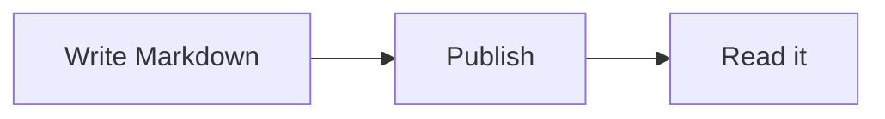

## Wiki links and embeds

A wiki link to the [[kitchen-sink]] and one with an alias: [[first-post|the first blog post]]. Linking here also gives those pages a "Links to this page" panel.

An embedded note:

![[page-header]]

## Math

Inline math, $e^{i\pi} + 1 = 0$, and a block:

$$
\int_0^1 x^2\,dx = \frac{1}{3}
$$

## Diagram

## A zoomable image

## PDF

![[demo.pdf]]
